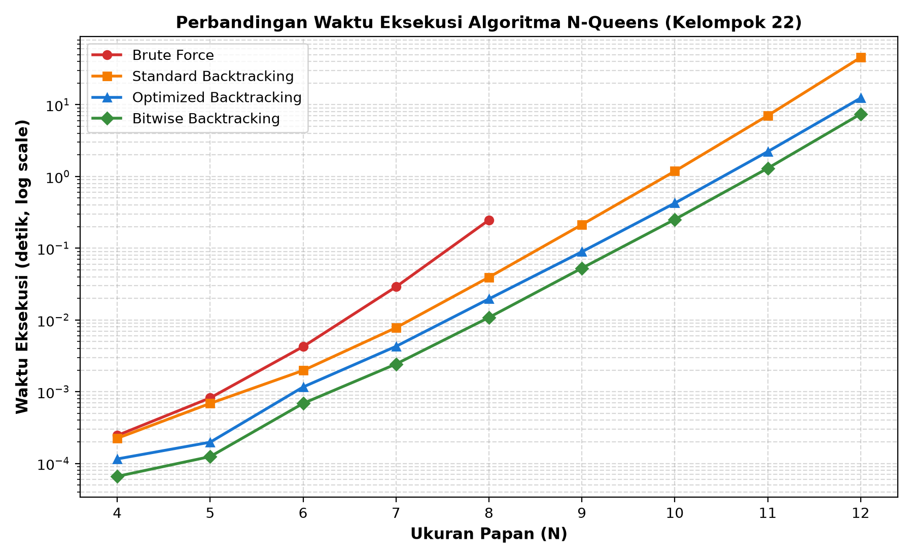
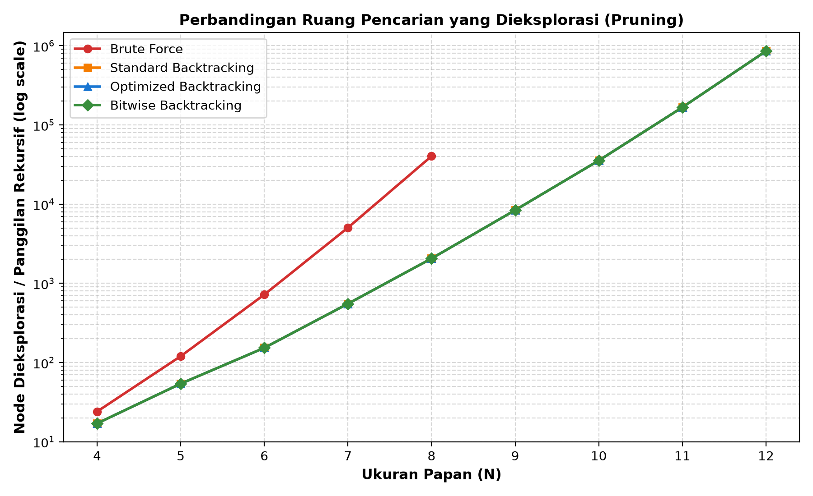
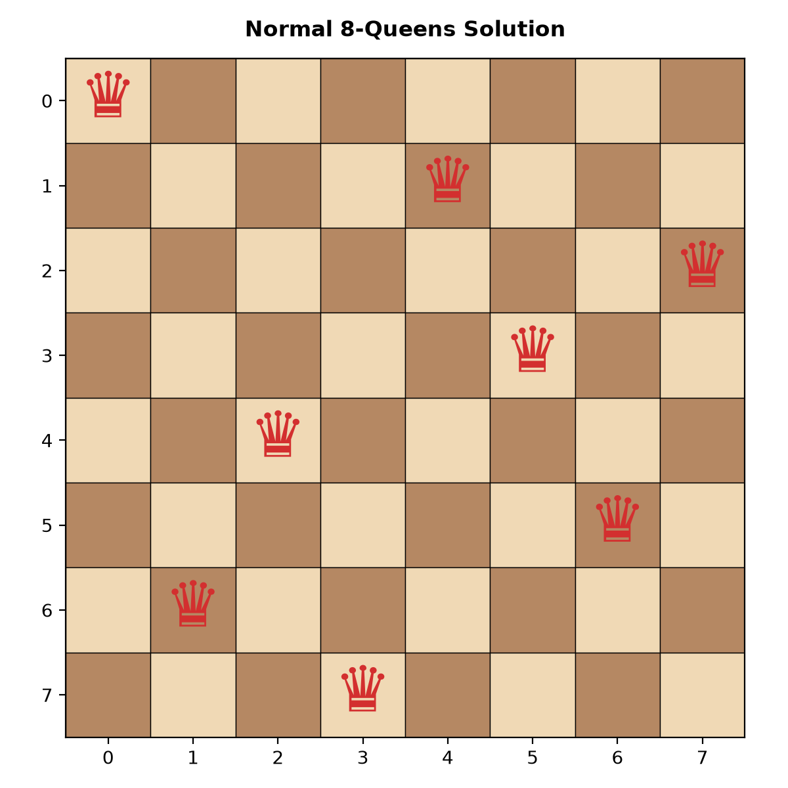
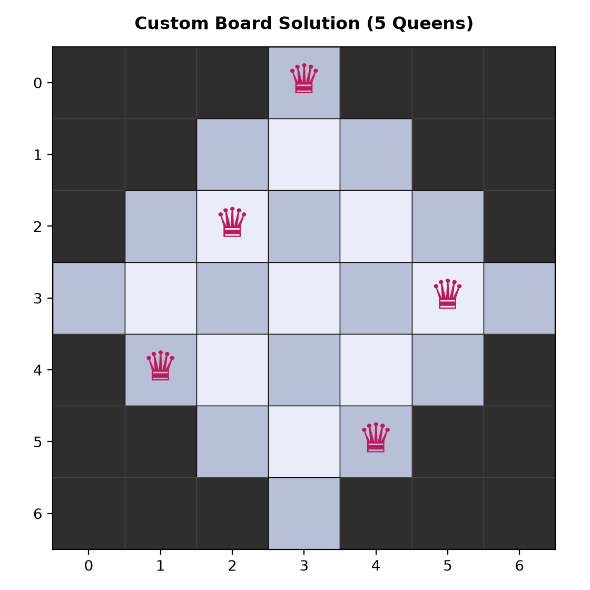
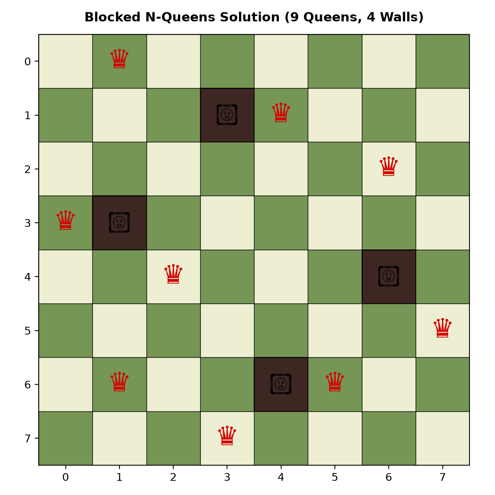

# Proyek Akhir Analisis Algoritme (KOM206)
## N-Queens Problem dan Variasinya (Normal, Custom Board, Blocked N-Queens)

**Kelompok 22 - Paralel 2**
Departemen Ilmu Komputer  
Sekolah Sains Data, Matematika, dan Informatika (SSMI)  
IPB University  

### Anggota Kelompok:
1. Muhammad Andhika Putra Pratama - M0403241055
2. Azra Aslam Khoiri - M0403241148
3. Afdha Auliya Atiq - M0403241163

---

## 1. Deskripsi Tugas
Proyek ini mengimplementasikan dan menganalisis penyelesaian masalah N-Queens serta dua variasinya menggunakan pendekatan Complete Search dan Backtracking, sesuai dengan materi kuliah Analisis Algoritme pekan 10.

Tiga kasus masalah yang dikerjakan:
1. **Normal N-Queens Problem:** Menempatkan N ratu pada papan catur N x N sedemikian sehingga tidak ada dua ratu yang saling menyerang (tidak satu baris, kolom, maupun diagonal).
2. **Custom Board N-Queens:** Menempatkan ratu pada papan dengan geometri dan topologi non-standar:
   - Papan persegi panjang (M x N)
   - Papan berbentuk belah ketupat (diamond)
   - Papan berbentuk lingkaran (circle)
   - Papan bentuk tangga / segitiga
   - Papan berbentuk palang (cross)
   - Papan berlubang di tengah (hole board)
   - Papan toroidal (wrap-around diagonal) dengan pembuktian Teorema George Polya (1918) bahwa solusi ada jika dan hanya jika gcd(N, 6) = 1.
3. **Blocked N-Queens:** Papan catur dengan rintangan/tembok (walls/pawns) yang menghalangi garis pandang serangan ratu (referensi: Gabriel Gimenez Franz, 2024). Di sini diuji pencarian solusi K ratu serta pencarian Board Value (jumlah ratu maksimum yang dapat diletakkan pada papan berintangan, yang bisa melebihi ukuran N pada papan standar).

---

## 2. Algoritme yang Diimplementasikan

Pada kasus Normal N-Queens, kami membandingkan 4 metode:
1. **Brute Force Permutasi:** Memeriksa seluruh kemungkinan susunan kolom (N!) dan memvalidasi apakah ada bentrokan diagonal.
2. **Standard Backtracking:** Menempatkan ratu baris demi baris. Pada setiap sel, dilakukan iterasi ke baris-baris sebelumnya untuk mengecek apakah posisi tersebut aman (O(N) per langkah).
3. **Optimized Backtracking (Array Lookup O(1)):** Menggunakan array penanda boolean `col`, `d1` (diagonal r + c), dan `d2` (diagonal r - c + n - 1) seperti yang diajarkan pada slide kuliah, sehingga pengecekan keamanan berjalan dalam O(1).
4. **Bitwise Backtracking:** Menggunakan operasi bit integer (bitmask) untuk merepresentasikan kolom dan diagonal yang diserang, serta menggunakan operasi `available & -available` untuk mengambil posisi aman berikutnya secara cepat.

Masing-masing algoritme mendukung 3 bentuk jawaban:
- **Decision:** Menemukan 1 solusi pertama yang valid.
- **Counting:** Menghitung total banyaknya solusi (diverifikasi dengan barisan OEIS A000170).
- **Enumeration:** Menampilkan seluruh konfigurasi solusi.

---

## 3. Struktur Direktori

```text
.
├── README.md
├── requirements.txt
├── main.py                     # Program CLI interaktif
├── src/
│   ├── normal_nqueens/         # Solver Normal N-Queens (Brute Force, Standard, Optimized, Bitwise)
│   ├── custom_board/           # Representasi papan kustom & solver
│   ├── blocked_nqueens/        # Solver Blocked N-Queens & preset
│   ├── benchmark/              # Modul pengujian waktu dan memori
│   └── visualizer/             # Visualisasi teks terminal dan plot matplotlib
├── tests/                      # Unit test (unittest)
├── examples/                   # Contoh script demo per kasus
└── output/                     # Hasil benchmark (CSV dan grafik plot PNG)
```

---

## 4. Cara Menjalankan Program

### Prasyarat
Program ini dibuat menggunakan Python 3. Tidak ada library eksternal wajib untuk menjalankan logika utama (semua algoritme memakai standard library Python).

Jika ingin menyimpan visualisasi dalam bentuk gambar grafik (.png), install matplotlib:
```bash
pip install -r requirements.txt
```

### Menjalankan Menu Interaktif
Jalankan file `main.py`:
```bash
python3 main.py
```
Akan muncul menu untuk memilih pengujian kasus Normal, Custom Board, Blocked N-Queens, Benchmark, atau Unit Tests.

### Menjalankan Contoh Demo
```bash
# Demo Normal N-Queens (N = 8)
python3 examples/demo_normal.py

# Demo Custom Board (Diamond & Toroidal)
python3 examples/demo_custom.py

# Demo Blocked N-Queens (9 Ratu pada papan 8x8 dengan rintangan)
python3 examples/demo_blocked.py

# Menjalankan Benchmark Lengkap N = 4 s.d 12
python3 examples/run_all_benchmarks.py
```

### Menjalankan Unit Test
```bash
python3 -m unittest discover tests -v
```

---

## 5. Hasil Pengujian dan Benchmark

Berikut adalah tabel hasil pengujian waktu eksekusi (detik) untuk mode Counting dari N = 4 sampai N = 12:

| N | Total Solusi (OEIS A000170) | Brute Force (dtk) | Standard Backtracking (dtk) | Optimized Lookup O(1) (dtk) | Bitwise Solver (dtk) |
|---|-----------------------------|-------------------|-----------------------------|-----------------------------|----------------------|
| 4 | 2 | 0.000149 | 0.000163 | 0.000082 | 0.000056 |
| 5 | 10 | 0.000597 | 0.000489 | 0.000150 | 0.000123 |
| 6 | 4 | 0.003808 | 0.002182 | 0.001227 | 0.000547 |
| 7 | 40 | 0.030936 | 0.008357 | 0.004728 | 0.003283 |
| 8 | 92 | 0.284645 | 0.042818 | 0.021263 | 0.012468 |
| 9 | 352 | - (dibatasi N<=8) | 0.234362 | 0.099340 | 0.062263 |
| 10 | 724 | - | 1.311349 | 0.474450 | 0.297113 |
| 11 | 2.680 | - | 7.854236 | 2.426130 | 1.528669 |
| 12 | 14.200 | - | 52.865534 | 13.552110 | 8.475574 |

### Grafik Hasil Pengujian:



### Contoh Solusi Visual:
| Normal 8-Queens | Custom Diamond Board | Blocked N-Queens (9 Ratu) |
| :---: | :---: | :---: |
|  |  |  |

### Pembahasan Singkat:
1. **Pemangkasan Cabang (Pruning):** Pada Brute Force, untuk N = 8 program harus mengecek seluruh 8! = 40.320 kemungkinan susunan. Sedangkan pada Backtracking, cabang yang sudah pasti menyerang langsung dipotong sehingga hanya 2.057 node yang dikunjungi.
2. **Pengaruh Lookup Array O(1):** Teknik array boolean dari slide kuliah terbukti mempercepat waktu komputasi sekitar 2.5 hingga 4 kali lipat dibanding Standard Backtracking pada N besar karena tidak perlu melakukan perulangan ke baris-baris atas setiap kali menaruh ratu.
3. **Bitwise Solver:** Metode bitwise adalah yang paling cepat karena pengecekan kolom dan kedua diagonal dilakukan secara paralel menggunakan bitmask integer.
4. **Custom Board & Blocked N-Queens:**
   - Pada papan Toroidal, hasil perhitungan kami mengonfirmasi Teorema Polya: saat N = 4, 6, 8 (yang kelipatan 2 atau 3), jumlah solusi = 0. Sementara saat N = 5 dan 7, solusi ditemukan masing-masing sebanyak 10 dan 28 solusi.
   - Pada Blocked N-Queens, penempatan rintangan yang tepat memutus garis pandang ratu sehingga papan 8x8 dapat menampung hingga 9 sampai 10 ratu tanpa saling serang.

---

## 6. Referensi
- Slide Perkuliahan Analisis Algoritme: *Complete Search & Backtracking (Pekan 10)*, Departemen Ilmu Komputer IPB.
- Gabriel Gimenez Franz (2024). *Blocked n-Queens*. https://gabrielgimenezfranz.com/blocked-n-queens/
- George Polya (1918). *Über die 'doppelt-periodischen' Lösungen des n-Damen-Problems*.
- OEIS Foundation. *Sequence A000170 (Number of ways to place n non-attacking queens on an n X n board)*. https://oeis.org/A000170
